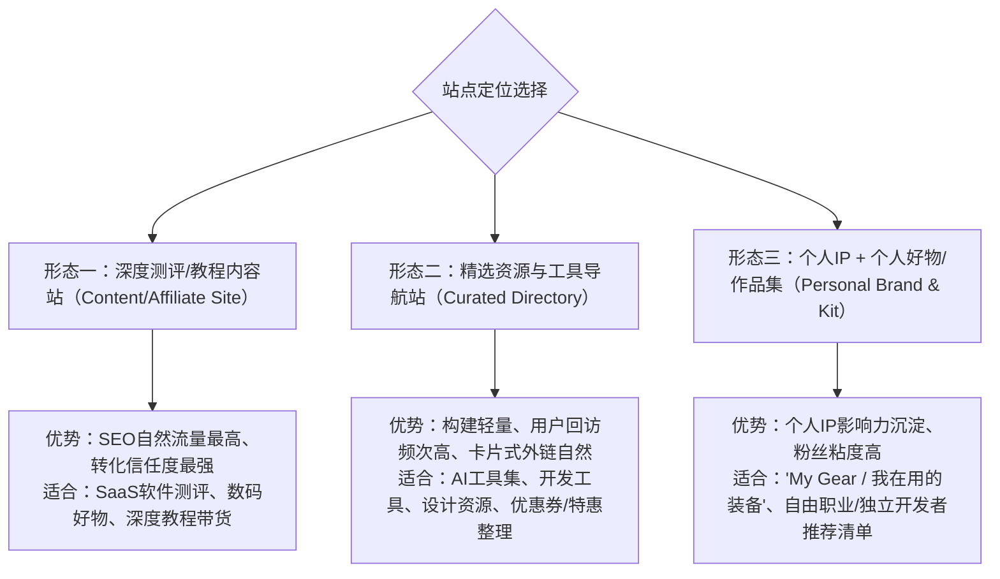

# 个人网站与返佣/导购商业化完整规划方案

建造一个具备**长效流量变现**与**返佣/商品带货能力**的个人网站，核心不在于一开始写多么复杂的系统，而在于**“高权重SEO架构 + 极佳的内容排版 + 可控的返佣短链转跳体系”**。

---

## 一、 核心定位与网站形态规划

根据商业化目标，推荐以下三种最适合挂靠返佣/商品链接的站点形态：



---

## 二、 推荐技术选型对比

| 维度 | 方案 A：现代静态站点（Astro / Next.js）🔥 **[强烈推荐]** | 方案 B：传统成熟 CMS（WordPress） | 方案 C：现代化极简写作平台（Ghost） |
| :--- | :--- | :--- | :--- |
| **技术基础** | 纯静态/Jamstack（SSG/SSR），部署在 Cloudflare / Vercel | PHP + MySQL，需运行在 VPS 主机上 | Node.js，专注现代写作与会员通讯 |
| **首屏性能 & SEO** | 接近 100 分满分（极致加载速度，搜索引擎极度青睐） | 插件多时较慢，需耗精力做静态缓存加速 | 原生优化优秀，代码简洁 |
| **维护成本** | **几乎零运维**（无需担心服务器宕机、数据库挂掉、黑客攻击） | 需定期维护插件、打安全补丁、防止注入勒索 | 中等，需轻量运维或使用官方托管 |
| **运营费用** | **完全免费**（Vercel / Cloudflare Pages 免费额度足够个人站使用） | 需常年续费云服务器/虚拟主机（约 ¥200~¥500/年） | 自建需服务器，托管费用较贵 |
| **内容编辑方式** | Markdown / MDX 本地写作，或绑定 Headless CMS（如 Notion/Strapi） | 类似 Word 的可视化后台编辑器 | 现代 Notion 式斜杠命令编辑器 |
| **返佣管理灵活性** | 高（通过代码自定义 `/go/xxx` 重定向路由，完全可控且无多余开销） | 高（有成熟插件如 ThirstyAffiliates, Pretty Links） | 中等（需手动配置转跳或改动路由代码） |

> [!TIP]
> **最佳实践推荐：采用 Astro 搭建**
> - **为什么是 Astro？** 它专注于**内容驱动型站点（Content-driven Websites）**，只向客户端发送零或极少的 JavaScript，加载速度秒开。
> - 内容使用 Markdown 或 MDX 文件撰写，支持在文章中直接插入交互式的「推荐卡片」、「对比表格」、「购买折扣按钮」等自定义组件。
> - 配合 GitHub + Cloudflare Pages / Vercel，**每次写完推送到 GitHub 即自动构建上线，全程零服务器费用**。

---

## 三、 返佣/商品链接的技术与工程化规范

挂靠商品/返佣链接时，有几个非常关键的技术要点直接影响到**SEO排名**和**收益稳定性**：

### 1. 统一短链重定向路由（Link Cloaking）
不要在正文里直接放带有一大串追踪参数的原始推广链接（例如 `https://partner.com/?aff_id=8923&sub_id=...`）。
- **做法**：在站点中设立专门的重定向接口，例如：
  - `https://yourdomain.com/go/notion`  302 临时重定向至 Notion 返佣推广链
  - `https://yourdomain.com/go/macbook` 302 临时重定向至 京东/亚马逊推广链
- **好处**：
  1. 页面干净，防止防拦截插件误判或用户反感；
  2. 若合作方或返佣平台更改推广链接，**只需修改配置文件中的一个映射项，全站所有涉及的地方自动生效**，无需一篇篇文章去替换；
  3. 方便对每次点击做精准的数据打点。

### 2. 搜索引擎规范标签（防降权）
Google 等搜索引擎对于联盟推广链接有严格的合规要求，所有外部返佣链接必须添加特定属性：
```html
<a href="/go/tool-name" target="_blank" rel="nofollow sponsored">
  获取专属折扣
</a>
```
- `rel="sponsored"`：明确告诉搜索引擎这是商业合作/推广链接；
- `rel="nofollow"`：防止站点的权重被无端外泄，避免被算法认定为垃圾买卖链接农场。

### 3. 数据埋点与出站分析（Outbound Link Analytics）
- 接入轻量合规的统计工具（如 **Google Analytics 4** 或开源无 Cookie 追踪的 **Umami** / **Plausible**）。
- 监听所有点击 `/go/` 链接的事件，实时了解**哪篇文章、哪个按钮、哪个产品转化率最高**。

### 4. 透明度声明（Affiliate Disclosure）
- 在网站页脚或文章开头附上免责与合作说明（如：*“本文包含合作链接，若通过本站链接下单，本站可能会获得一定佣金，但这不会影响您的购买价格与测评客观性”*）。
- 提升读者信任感，同时规避各类广告法及联盟平台的合规封号风险。

---

## 四、 分阶段实施执行路线图


### 阶段一：定位与域名基建
1. **明确目标市场**：
   - 若面向**国内用户**：必须考虑国内服务器需要工信部 ICP 备案；或采用境外免备案节点（如香港 CDN），但访问延迟需做权衡。
   - 若面向**出海/海外用户**：无需备案，直接使用 Cloudflare + Vercel，全球 CDN 节点加速极佳。
2. **域名选购**：
   - 建议在 Namesilo / Namecheap / Spaceship / 腾讯云 等平台注册一个简短易记的 `.com` 或 `.io` 域名。
   - 接入 Cloudflare 提供免费的 DNS 解析、全球加速与 SSL 证书。

### 阶段二：框架与页面开发
1. 初始化项目（建议由我为你直接搭建基于 **Astro** 的现代化主题）。
2. 构建核心页面结构：
   - **首页（Home）**：个人定位、精选文章横幅、推荐好物一览、最新动态。
   - **博客/评测列表页（Blog / Reviews）**：支持按分类、标签快速筛选。
   - **资源/好物专区（Gear / Directory）**：卡片式陈列所有工具和商品。
   - **关于与声明页（About & Disclosure）**：个人介绍、合规声明、联系方式。

### 阶段三：返佣链路与组件化开发
1. 实现 `/go/[slug]` 动态重定向路由（支持静态配置表或 JSON 维护）。
2. 开发专属的高转化 UI 组件：
   - **ProductCard（商品卡片）**：展示封面图、核心卖点、价格、高亮行动按钮。
   - **ComparisonTable（对比横评表）**：多款同类竞品参数横向对比。
   - **CouponBox（优惠码领取框）**：一键复制优惠券代码。
3. 接入 GA4 / Umami 统计代码，配置自定义出站点击事件。

### 阶段四：内容填充与部署发布
1. 编写 3~5 篇高质量的种子评测/推荐文章（打好 SEO 基础）。
2. 关联各联盟渠道：
   - **SaaS/软件类**：Impact.com、Rewardful、FirstPromoter、各软件官网自带的 Affiliate Program；
   - **实物/电商类**：亚马逊联盟（Amazon Associates）、京东联盟、淘宝客、多多进宝等。
3. 关联 GitHub 仓库，配置自动化部署（CI/CD），代码一推即可全自动发布。

### 阶段五：长期运营与 SEO 增长
- 建立 Google Search Console / 百度搜索资源平台 索引提交。
- 关注长尾关键词（如：“XX工具深度横评”、“XX替代方案”、“XX最划算购买攻略”）。
